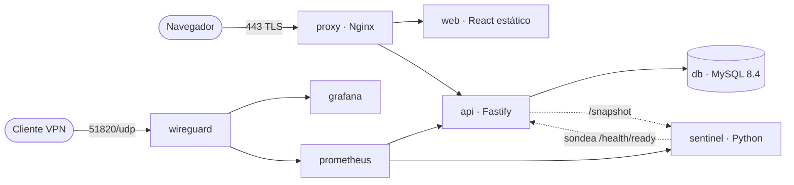

# Faro · Observatorio del despliegue

Entorno DevOps completo y pequeño: una interfaz que muestra, en tiempo real, el recorrido de una
petición a través de **proxy → web → API → base de datos**, y deja enviar una "señal" que se guarda
en MySQL. Es la evolución del laboratorio *Arquitectura multicontenedor con Docker Compose* del
Taller Final de Docker.

| Requisito del taller | Dónde está |
|---|---|
| Docker Compose multicapa | `docker-compose.yml` (borde, presentación, lógica, datos, monitoreo; 3 redes) |
| Proxy inverso con SSL | `deploy/proxy/default.conf.template` + `make certs` / `make letsencrypt-issue` |
| Acceso seguro vía VPN | Servicio `wireguard`: el monitoreo **no publica ningún puerto** |
| Monitoreo | Prometheus + Grafana + un *sentinel* propio en Python (`apps/sentinel`) |
| Scripts de automatización | `ops/faro_ops.py` (CLI en Python) + `Makefile` + CI |

## Arquitectura



Tres redes de Docker, dos de ellas `internal: true` (sin salida a Internet ni puertos en el host):

- `edge`: la única expuesta. Publica **80/tcp, 443/tcp y 51820/udp**, nada más.
- `app`: proxy ↔ web ↔ api ↔ db. La base de datos solo existe aquí.
- `mgmt`: Prometheus, Grafana, sentinel y WireGuard. Se administra únicamente por la VPN.

## Inicio rápido

Requisitos: Docker con Compose v2, Python 3 y OpenSSL (en Ubuntu: `sudo apt install docker.io docker-compose-v2 python3 openssl make`).

```bash
make doctor     # revisa requisitos y puertos
make up         # genera secretos y certificado, construye y levanta todo
make smoke      # 8 pruebas de extremo a extremo
```

Abre `https://faro.localhost`. El navegador avisará del certificado porque lo firma una CA local:
importa `deploy/certs/ca.crt` o, con curl, usa `--cacert deploy/certs/ca.crt`.
Si los puertos 80/443 están ocupados, cambia `HTTP_PORT`, `HTTPS_PORT` y `PUBLIC_URL` en `.env`
(por ejemplo 8080, 8443 y `https://faro.localhost:8443`).

`make help` lista todos los comandos. Los más usados: `make logs S=api`, `make ps`, `make down`.

## Acceso por VPN (WireGuard)

Grafana y Prometheus no tienen puertos publicados. Para entrar:

1. En `.env` pon `WG_SERVERURL` con la IP o dominio público del servidor (o deja `auto`) y los clientes en `WG_PEERS`.
2. `make up` y luego `make vpn PEER=laptop` imprime la configuración del cliente (o `make vpn-qr PEER=celular` para escanearla con la app de WireGuard).
3. Con el túnel activo abre `http://grafana:3000` (usuario `admin`, contraseña en `deploy/secrets/grafana_admin_password.txt`) y `http://prometheus:9090`.

Los nombres se resuelven porque `PEERDNS=auto` reenvía al DNS interno de Docker. El túnel es *dividido*:
solo viaja por él el tráfico hacia `10.13.13.0/24` y `172.28.0.0/24`; el resto de tu Internet no cambia.
`make vpn-status` muestra los clientes conectados.

## Monitoreo

- **API** (`/metrics`): histograma de duración por ruta y código, contador de señales, métricas de proceso.
- **Sentinel** (Python/FastAPI): sondea `/health/ready` cada 10 s, lee la vigencia del certificado TLS desde disco y expone `/metrics` y `/snapshot`. La API reutiliza ese snapshot para pintar la telemetría de la interfaz.
- **Prometheus**: reglas en `deploy/monitoring/rules.yml` (API caída, sonda fallando, certificado a < 14 días, p95 alto, tasa de 5xx).
- **Grafana**: datasource y dashboard «Faro · Visión general» aprovisionados automáticamente.

No se incluye Alertmanager: las alertas se ven en Prometheus/Grafana, pero no se envían por correo.

## Automatización (`ops/faro_ops.py`, solo biblioteca estándar)

| Comando | Qué hace |
|---|---|
| `make init` | Secretos aleatorios (`secrets.token_urlsafe`) y `.env`. Idempotente. |
| `make certs` | CA local + certificado ECDSA P-256 con SAN (`faro.localhost`, `localhost`, `127.0.0.1`). |
| `make doctor` | Docker, Compose, OpenSSL, secretos, vigencia del certificado y puertos libres. |
| `make smoke` | HTTP→HTTPS, TLS verificado, cabeceras, API, escritura y lectura en MySQL, `/metrics` oculto. |
| `make backup` / `make restore FILE=…` | `mysqldump` comprimido en streaming, con retención de 7 copias. |
| `make letsencrypt-issue` / `-renew` | Certificado público con Certbot (reto HTTP-01) y recarga de Nginx. Programa la renovación con `cron`. |

## Seguridad: decisiones principales

- **Secretos fuera del código y de las variables de entorno**: Docker secrets en archivos (`deploy/secrets/`, ignorados por Git). La API acepta `DB_PASSWORD_FILE`; MySQL y Grafana soportan `*_FILE`.
- **Mínimo privilegio**: ningún contenedor propio corre como root; `cap_drop: ALL`, `no-new-privileges` y sistema de archivos de solo lectura en API y sentinel. WireGuard es el único con una capacidad añadida (`NET_ADMIN`).
- **Aislamiento de red**: la base de datos nunca tiene acceso a Internet ni a un puerto del host.
- **Nginx**: TLS 1.2/1.3 con suites modernas, HSTS, CSP estricta, `X-Frame-Options`, `nosniff`, `Referrer-Policy`; límite de 10 req/s por IP; rechaza peticiones con `Host` desconocido; `X-Forwarded-For` se sobrescribe (no se puede falsificar); `/metrics` y `/health` no se enrutan.
- **API**: validación con Zod, consultas preparadas (sin SQL concatenado), Helmet, *rate limit* global y más estricto en escritura, errores 5xx sin detalles internos, cuerpo máximo de 4 KiB.
- **Cliente**: React escapa el texto de las señales; la CSP bloquea scripts y estilos en línea.
- **Permisos de secretos y claves**: archivos `0644` dentro de directorios `0700`. Es deliberado: Docker monta el archivo con los permisos del anfitrión y los contenedores corren sin privilegios, así que `0600` los dejaría sin lectura (ver `write_private` en `ops/faro_ops.py`).

## Estructura

```
apps/
  web/        React 19 + TypeScript + Vite + Tailwind v4 (diseño en src/styles)
  api/        Node 22 + Fastify 5 + TypeScript (repositorio inyectable)
  sentinel/   Python 3.12 + FastAPI + prometheus-client
deploy/       proxy, esquema SQL, monitoreo; secrets/ certs/ wireguard/ (generados, no versionados)
ops/          CLI de automatización y sus pruebas
tools/        validador de commits
PRODUCT.md DESIGN.md   contexto y sistema de diseño (convención de Impeccable)
```

## Diseño y la librería Impeccable

Impeccable no es una librería de componentes: es un vocabulario de diseño para agentes de IA con un
detector de "patrones genéricos". Aquí se aplica de dos formas:

1. `PRODUCT.md` y `DESIGN.md` documentan el contexto y las decisiones antes de escribir CSS.
2. `make design-check` ejecuta `npx impeccable detect src/` (también en CI).

**Tailwind v4 y separación de responsabilidades**: los tokens viven en `tokens.css` (`@theme`) y cada
componente tiene su CSS con nombres semánticos (`route__stop`, `button`) construido con `@apply`.
Los `.tsx` no contienen ni una utilidad. `npm run lint:design` lo hace cumplir y falla si aparece
una clase que no esté definida o un `className` dinámico.

## Pruebas y calidad

```bash
make setup && make test
```

API 20 pruebas (Vitest, repositorio en memoria), sentinel 12 (pytest), web 11 + verificación de clases, ops 10 (`unittest`).
CI (`.github/workflows/ci.yml`) además construye las imágenes y ejecuta `make smoke` contra el entorno levantado.

## Convención de commits

Conventional Commits en español, **máximo 50 caracteres** en el asunto: `feat(api): agrega ruta de señales`.
`make hooks` activa un hook que lo valida; `make lint` revisa el historial.

## Diferencias frente a la guía original del laboratorio

| Guía | Faro |
|---|---|
| `CREATE laboratorio;` (SQL inválido) | `CREATE TABLE` sobre la base que crea la imagen (`MYSQL_DATABASE`) |
| `-predes123` en la verificación (contraseña mal escrita) | Sin contraseñas en comandos: se leen del secreto dentro del contenedor |
| Contraseña `redes123` fija y por defecto en el código | Secretos aleatorios por instalación; la API falla si no hay contraseña |
| `fetch('http://localhost:3000')` (solo funciona en la misma máquina) | Ruta relativa `/api` a través del proxy |
| Backend publicado en el puerto 3000, MySQL como `root` | Solo el proxy publica puertos; la API usa un usuario propio sin privilegios de administración |
| `version: '3.8'` (obsoleto) y `mysql:8.0` (fin de soporte) | Compose sin `version`, `mysql:8.4` LTS |
| `depends_on` sin esperar a la base de datos | `healthcheck` + `condition: service_healthy` |

## Solución de problemas

- **`address already in use`**: cambia `HTTP_PORT`/`HTTPS_PORT` en `.env` (ver arriba) o libera 80/443.
- **WireGuard no arranca en Docker Desktop (Mac/Windows)**: necesita un kernel Linux con el módulo `wireguard`. Funciona en Ubuntu/WSL2 recientes; para pruebas sin VPN: `docker compose up -d --scale wireguard=0`.
- **El navegador desconfía del certificado**: importa `deploy/certs/ca.crt` como autoridad raíz.
- **Cambié las contraseñas con `make init ARGS=--force` y MySQL rechaza la conexión**: la base conserva la contraseña antigua en su volumen; `make clean` (borra los datos) y `make up`.
- **La telemetría dice «el sentinel no está reportando»**: `make logs S=sentinel`.

## Alcance y límites conocidos

- Sin Alertmanager, sin tracing ni logs centralizados (Loki): añadirlos es el siguiente paso natural.
- Un solo nodo: no hay alta disponibilidad de MySQL ni balanceo.
- La API guarda mensajes públicos sin autenticación: es una demostración de infraestructura, no un producto.
